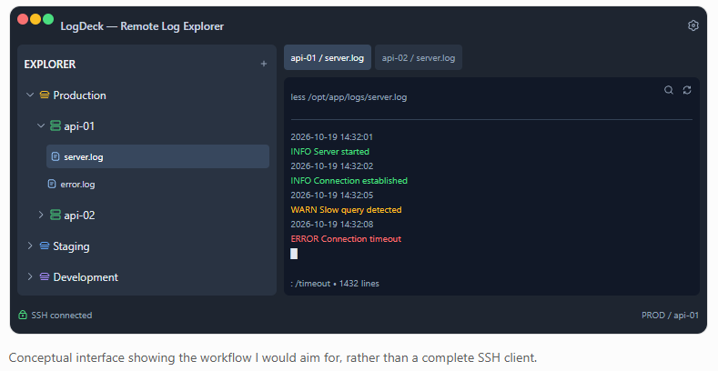

# LogChard

*Each server is a tree, and all your logs live in one orchard.*

LogChard (short for **LogOrchard**) is a remote log explorer with an embedded
terminal — not another general-purpose SSH client. It removes the repetitive
"SSH in, cd to logs, `less server.log`" dance when you work with a dozen
servers across several environments.

## Concept

- Persistent environment → server → log-file tree in a sidebar.
- Double-click a configured log file → SSH session opens `less` on it in an
  embedded terminal tab.
- Keep all your familiar `less` muscle memory (`/`, `?`, `G`, `F`, `n`, `N`).
- Your existing `~/.ssh/config` stays the source of truth for connectivity —
  aliases, jump hosts, agent auth, certificates all keep working.
- The app only stores its own layer: environment grouping, host aliases, and
  named log paths.
- MCP server + companion CLI so AI assistants (Claude Desktop/CLI) can read
  and reason about your logs — bounded, configured-paths-only access.
  See [docs/design.md](docs/design.md).



## Status

Working MVP on `spike/pty-backend`: environment tree, YAML config,
`~/.ssh/config` host import, tabbed `ssh -tt … less` sessions, tmux-backed
resume, reconnect with backoff, live-follow mode (`less +F`), cross-server
grep, and split panes.

Headless tools sharing the same config (`bin/`):

```
logchard list | path | read <host> <log> [N] | search <pattern>
logchard-mcp   # MCP server (stdio)
```

MCP tools: `list_environments` · `read_log` · `search_logs` (bounded,
configured paths only) · `list_ssh_hosts` · `add/remove` for environments,
servers, and logs — an AI assistant can manage your connections and fetch
logs through your own ssh config without ever touching credentials.

See [docs/design.md](docs/design.md) for architecture,
[docs/spike-01-pty.md](docs/spike-01-pty.md) for PTY findings,
[docs/web.md](docs/web.md) for the web-build investigation, and
[docs/idea.md](docs/idea.md) for the original analysis.

## Platform targets

| Platform | Priority | Notes |
| -------- | -------- | ----- |
| Linux (Fedora) | Primary | Development target |
| Windows | Later | Needs ConPTY for local `ssh` spawning |
| Web | Maybe | Browser can't open raw SSH sockets — requires a relay backend |

## Planned stack

- **Flutter** — UI (sidebar, tabs, settings)
- **[xterm.dart](https://pub.dev/packages/xterm)** — embedded terminal
- **System OpenSSH + local PTY** — connection backend on desktop, via a
  vendored/patched `package:pty` ([dartssh2](https://pub.dev/packages/dartssh2)
  as a fallback / mobile path)
- **YAML in the app-support dir** — environments, servers, log definitions
  (human-readable, diffable, shared with the CLI/MCP executables)
- **OS keyring** — any credentials the app must store itself
